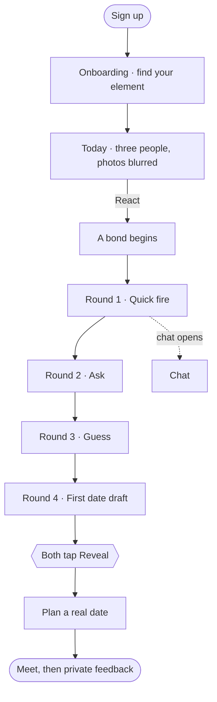

# Covalent

### Bonds are shared, not swiped.

**A dating app where you get to know someone _before_ you see them.**

Three verified people a day · photos that sharpen as you talk · a real date at the end

[**Open the live app →**](https://covalent-nine.vercel.app)

 

## The idea

Most dating apps judge a person in half a second, from a photo. Covalent turns that around.

Every evening you meet **three people**, not three hundred. Their photos start **blurred**. To see someone, the two of you play **four short rounds** together: quick-fire picks, one real question each, guessing each other's answers, and sketching a first date. With every round you both finish, the photo sharpens a little. After the last one, you choose together to reveal.

By the time you see each other's faces, you already know whether you click. The only thing left to do is meet, so the app helps you plan a real date in a public place.

In chemistry, a *covalent bond* is one where both atoms share. That's the whole product: **nothing happens unless both people put something in.**

 

## The journey at a glance

 

## 1 · Sign up

Sign up with **email**, **Google** or **GitHub**. *Continue with eLitmus ID* is shown as coming soon.

Everyone confirms their **date of birth (18+ only)** and gives three separate consents:

- the Terms and Community guidelines
- the Privacy notice
- the **eLitmus data firewall**: *your Covalent data is never shared with eLitmus recruiters or employers*

Marketing emails are a separate opt-in. People who sign up with Google or GitHub see a short **"Almost there"** screen for the same checks before they start.

 

## 2 · Onboarding: find your element

Six short steps, one decision per screen:

| Step | What you do |
|---|---|
| **About you** | First name (surnames never appear), who you are and who you'd like to meet, your city, and what you do |
| **Intent** | *Something serious*, *Dating to see where it goes*, or *New in the city, friends first* |
| **Values** | A 10-question quiz on a five-point scale between two poles. This drives matching. |
| **Elements** | Pick 5–8 of 40 "elements" (chai, cricket, filter coffee, chess…): things you'd happily talk about for an hour |
| **Prompts** | Answer three prompts. Specific beats clever. |
| **Photos** | Add 1–4 photos. They're blurred **on our server**, so nobody can peek early. |

Onboarding ends on its high point: **your element**. Your quiz answers map you to one of 12 archetypes, like *Carbon: the connector* or *Gold: loyal, rare, values first*. You get a story-sized card to download and share on Instagram or WhatsApp.

Bengaluru and Hyderabad are live. People in other cities join a **waitlist**, because Covalent launches one city at a time so every batch is worth opening.

 

## 3 · Today: three people, not three hundred

Every day at **8 PM IST** you get a new batch of **three people**. Each card shows:

- a **blurred** photo
- first name, age and a **Verified** badge
- their role, element and intent
- a **"why you two"** line explaining the match: shared values, elements, even the same hometown

For each person you either **react**, which starts a bond, or **pass**.

When you've seen all three, the app says so plainly, *"That's today's batch"*, and shows a countdown to the next one. No infinite scroll, no reason to keep checking.

 

## 4 · Bonds: fewer, better connections

Reacting to someone starts a **bond**. A real person receives an **invite** they can accept, and demo profiles accept straight away.

- **Three bond slots at a time.** To start a fourth, you finish or close one first. Matches can't be hoarded.
- **72 hours of silence closes a bond**, kindly and automatically. You can also **dissolve** a bond in one tap with an optional reason. Built-in closure replaces ghosting.
- A **chemistry score** starts from your match score and grows with every round you play. It reads *Inert*, then *Warming*, then *Reactive*, then *Covalent*.
- The tab bar shows a badge when it's **your move**.

 

## 5 · The four rounds

The heart of Covalent. You both get the same draw of questions. **Your partner's answers stay hidden until you've both played**, so nobody can copy.

| Round | What you do | The photo after it |
|---|---|---|
| **1 · Quick fire** | Eight this-or-thats. Don't overthink it. | Sharpens a little: a shape |
| **2 · Ask** | Pick one of three questions for them to answer, and answer the one they pick for you. React to their answer with an emoji. | A hint of features |
| **3 · Guess** | Five statements. Answer for yourself, then predict what they said. | Soft but recognisable |
| **4 · First date draft** | Pick two date ideas and a time slot. Covalent finds the overlap. | Ready to reveal |

Before any round, a photo shows only **colour and mood**. After each round, a short note in the chat sums it up, like *"Round 4 · You both picked the same date idea. Someone book it."*

Every blur level is rendered **on the server**. The app only ever sends the version you've earned, so a sharp photo can't be pulled out of the browser. On your profile, a slider lets you preview exactly what someone sees of you at each stage.

 

## 6 · The reveal

After round four, each of you taps **Reveal**. The photos go sharp only when **both** have tapped. It's mutual, like everything else.

The reveal screen shows your final chemistry and one of their prompt answers: *"You got here on conversation, not a photo. Now make it real."* Then you get two choices: **Plan a first date**, or **Keep chatting first**.

 

## 7 · Chat

Chat opens once you've **both finished round one**, so the first message is never just "hey". Your rounds give you something real to talk about.

- Messages arrive **live**, in under a second.
- Round results appear in the conversation as small notes.
- Try to share a phone number, UPI ID, email or social handle before the reveal, and Covalent **checks with you first**. It's a gentle nudge to keep things on the app until you know each other.
- **Report** and **block** are always one tap away.

 

## 8 · Plan a real date

Dates happen in **public places only**: partner cafés and restaurants in your city.

1. **Propose** a venue and time. Your match can **accept** or **suggest another**.
2. Once you both agree, each of you pays a **₹99 commitment** through a UPI-style checkout. It isn't a fee: **it comes back as ₹99 off your bill** at the venue. If someone doesn't show up, they lose it, which keeps no-shows rare. Cancelling refunds it.
3. **Share the plan with a trusted contact.** A private link shows a friend just the first names, venue and time.

*The checkout runs in test mode: no real money moves.*

 

## 9 · After the date

Once the date has happened, Covalent asks three private questions: **Did they show up? Did you feel safe? Would you meet again?** There's also an optional note for the team.

Only *"showed up"* affects the other person's **reliability score**. Everything else stays private and helps us keep the community safe. Showing up builds reliability and earns a **Reliable** badge. No-shows cost more than shows earn.

 

## 10 · You

Your own space:

- your **element** and share card
- your **reliability**, and whether you're **verified**
- **"How others see you"**: drag a slider to see your photo exactly as a match sees it at each round
- **Catalysts**: small optional boosts for busy weeks
  - a fourth bond slot for a week
  - extend a bond by 48 hours
  - one extra pick today

  They cost **₹39 each, or ₹99 for three**, and you never need one to meet someone.
- **Settings**: edit your profile, manage blocks, **download all your data**, or **delete your account** for good

 

## Safety, built in

- **Verified profiles.** eLitmus already knows each candidate's real identity, so a "Verified" badge means something.
- **18+ only**, with a date-of-birth check at sign-up.
- **Report and block everywhere**: on cards, in bonds and in chat. Reports go to a moderation queue.
- **Your photos are protected.** Blur is enforced on the server, and nobody can see you sharp before a mutual reveal.
- **Public places only** for dates, plus a trusted-contact share link.
- **Your data is yours.** You can export it or delete your account, and nothing you do here reaches recruiters.

 

## Try it yourself

Open **[covalent-nine.vercel.app](https://covalent-nine.vercel.app)** on your phone, or use one of four pre-seeded accounts. Each sits at a different point in the journey (the password is shared in the submission form):

| Account | Where you'll start |
|---|---|
| `aarohi@covalent.test` | **Fresh.** A full batch of three is waiting. |
| `kabir@covalent.test` | **Mid-rounds.** A bond with **Naina** (another tester: open both in two browsers to watch chat arrive live) and one with a demo profile. |
| `naina@covalent.test` | **Revealed.** A chat history with Arjun. Plan a date and try the checkout. |
| `dhruv@covalent.test` | **Dates.** One date coming up and one waiting for feedback. Also has the founder dashboard at `/admin`. |

The other people you'll meet are **demo profiles**: fictional, labelled *Demo profile*, with illustrated avatars. They accept reactions instantly and play each round back within a few seconds, so you can try the whole journey on your own.

Each account has a **Demo** tab with *New batch now*, *Skip partner wait* and *Reset this account*.

 

---

**Want to look under the hood?**

[Development guide](docs/DEVELOPMENT.md) · [Why it's built this way](docs/DECISIONS.md) · [Build log](docs/BUILD_LOG.md) · [Product brief](plan.md)

Built for the eLitmus product assignment · Next.js · Supabase · Vercel

